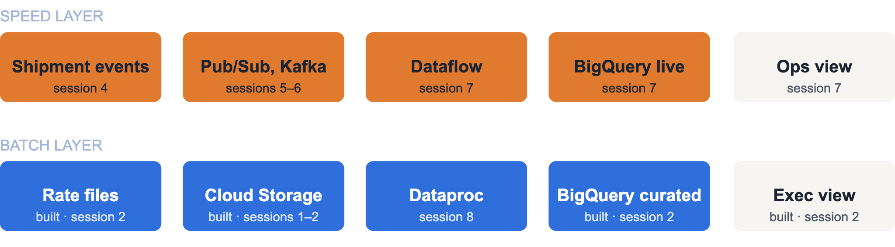
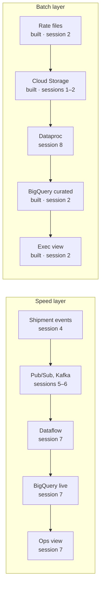

# Reference architecture

This is the platform everyone starts from in session 3. It's a Lambda architecture: tracking events stream because operations needs them live, and rate files arrive daily because that's how carriers send them.

- **Speed layer:** shipment events flow through Pub/Sub and Kafka into Dataflow, which writes live tables in BigQuery for the ops view.
- **Batch layer:** rate files land in Cloud Storage, Dataproc processes them, and the results go into curated BigQuery tables for the exec view.

The boxes marked "built" are the ones you have after sessions 1 and 2. The others come session by session, as labelled. Session 10 makes the whole platform production-ready.

Your own design can change this, as long as you can justify the change for your shipper.

## Copy and adapt

The same diagram in Mermaid, if you'd rather edit text than draw. Paste it into a Markdown file in your fork and GitHub draws it.

