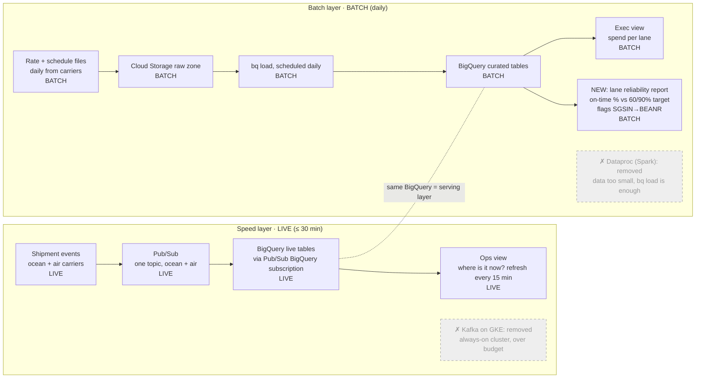

# Architecture: Coastline Fashion (SHP06)

Adapted from the reference platform (`architecture/`). Coastline's targets: **freshness 30 minutes**, reliability **60% ocean / 90% air**, budget **$25 per month**, focus **cost**.

- **LIVE** = must meet the 30-minute freshness target.
- **BATCH** = runs on a schedule.
- ✗ grey dashed boxes = in the reference platform, but removed for this customer.

## Changes from the reference platform

| Box | Change | Why (Coastline) |
|---|---|---|
| Kafka on GKE (ocean) | **Removed**: ocean and air events both go through Pub/Sub | An always-on Kubernetes cluster alone would use up most or all of a $25 budget; 30-minute freshness doesn't need it. |
| Dataflow (streaming) | **Replaced** by a Pub/Sub → BigQuery subscription | No always-on workers; events are written straight to a table. Add Dataflow only if we need event-time windows later. |
| Dataproc (Spark) | **Removed**; keep `bq load` | About 2 MB of files a month. Spark adds a cluster to run and pay for with no benefit at this size. |
| Ops view | **Refresh every 15 min**, not continuously | Meets 30 minutes with slack, and cuts dashboard query cost. |
| Lane reliability report | **Added** | Coastline's reliability target is per lane; SGSIN → BEANR already misses it (`docs/metrics.md`). |
| Databricks ML | **Later / optional** | Not needed for any of Coastline's three targets yet. |
| Underneath (Terraform, IAM, monitoring) | Kept | Needed for any design. |
